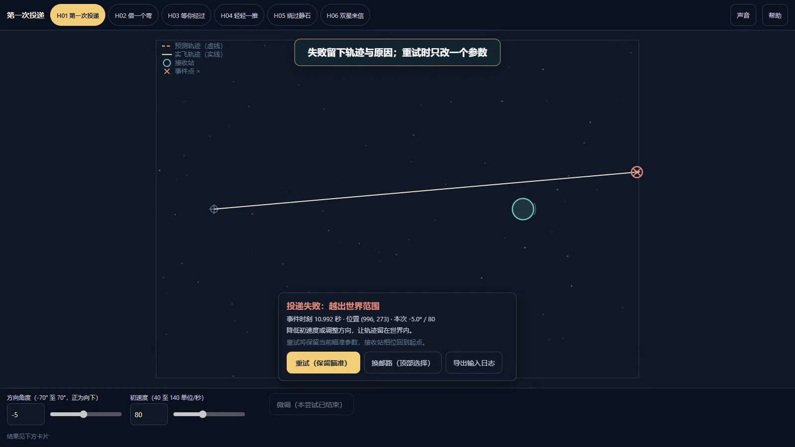

# 引力邮差

把信送到相遇的那个瞬间。

Atria Demo 共建作品 · 作者 **xyc**。主体开发 Qoder/Atria；Codex 独立评审、最终修复与提交整理。



## 直接体验

下载或克隆本仓库，进入根目录：

```text
node serve-demo.mjs
```

打开 http://127.0.0.1:8000/ 。仅监听本机；不需要 API Key。需要 Node.js 24.21（实际测试版本）。仓库已含 dist，可不安装依赖直接运行。

## 从源码开发

```text
pnpm install --frozen-lockfile
pnpm test
pnpm build
node serve-demo.mjs
```


## 功能与使用说明

见 [Demo说明.md](Demo说明.md)。56 项物理、渲染和会话测试通过；类型检查与生产构建通过。

邮路不是强制闯关，失败不消耗长期资源。预测与实飞一致不等于经过真人难度平衡验证；手机真机性能及多人盲玩仍未测试。

公开的是本次提交快照，不包含私人开发仓库历史、凭据、node_modules 或无关项目。第三方库及数据遵循各自声明；本仓库公开不代表作者有权替第三方重新授权。

